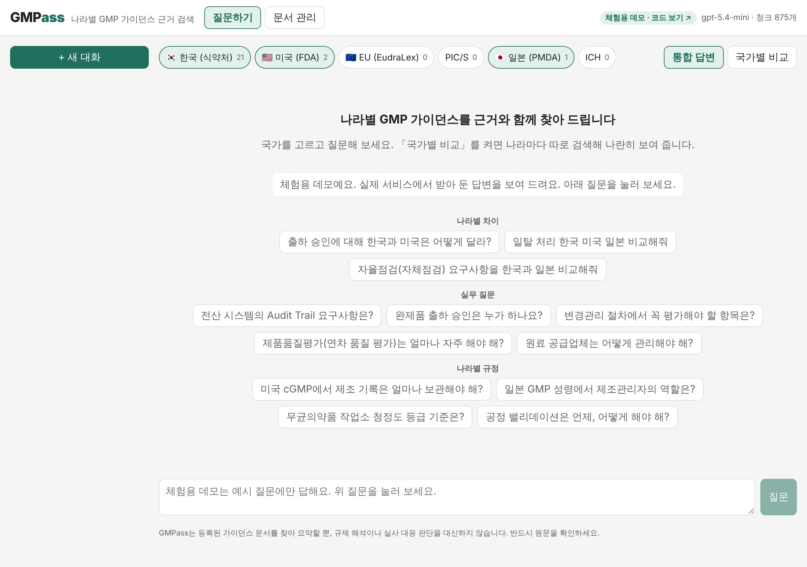
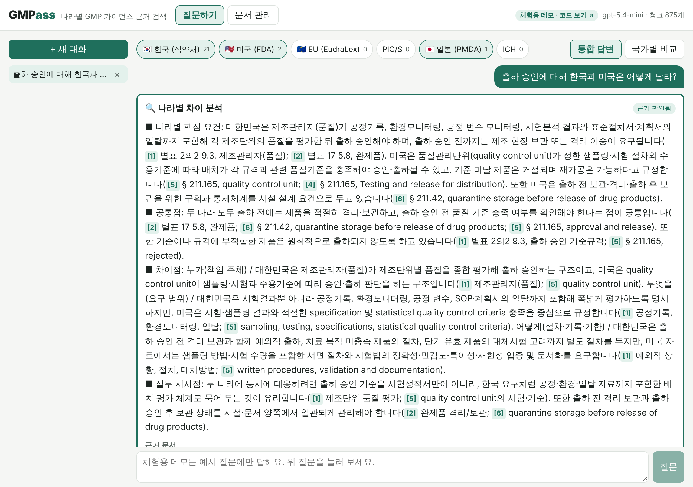

# GMPass

> 나라별 GMP 규정을 **근거 조항과 함께** 찾아 주고, 같은 주제에 대한 한국·미국·일본의 요구사항을 **나란히 비교**하는 AI 챗봇

### 🔗 [바로 체험해 보기 → fkmc10101-hub.github.io/GMPass](https://fkmc10101-hub.github.io/GMPass/)

설치나 로그인 없이 브라우저에서 바로 열립니다. 예시 질문을 누르면 실제 서비스에서 받아 둔 답변과 근거 조항, 영어·일본어 원문의 한국어 번역을 볼 수 있습니다.
(체험판은 비용이 들지 않도록 미리 준비한 질문에만 답합니다. 실제 서비스는 어떤 질문이든 실시간으로 검색하고 답합니다.)

| 첫 화면 | "출하 승인에 대해 한국과 미국은 어떻게 달라?" |
|---|---|
|  |  |

---

## 한눈에 보기

**왜 만들었나요?**
제약회사 품질보증(QA) 담당자로 2년간 일하면서, 같은 주제를 식약처 규정, 미국 FDA 규정(21 CFR), 일본 GMP 성령에서 따로 찾아 대조하는 일이 반복됐습니다. 규정은 나라마다 언어도, 조항 체계도 다릅니다. "출하 승인은 누가 해?"라는 질문 하나에도 세 나라 문서를 열어 봐야 했습니다. GMPass는 이 일을 질문 하나로 줄이려고 만든 개인 프로젝트입니다.

**무엇을 하나요?**
- 한국어로 물으면 한국어·영어·일본어 원문에서 관련 조항을 찾아, 한국어로 답하고 문장마다 근거 번호 `[1]`을 붙입니다.
- "한국과 미국은 어떻게 달라?"처럼 물으면 나라별로 따로 찾아 **공통점·차이점**을 정리합니다.
- 근거가 약하면 "검토 필요"와 그 이유를 함께 표시합니다. 규정 업무는 틀린 답보다 "모른다"가 낫기 때문입니다.
- 영어·일본어 조항은 버튼 하나로 한국어 번역을 볼 수 있습니다 (판단은 원문 기준이라는 안내와 함께).

**어떻게 확인했나요?**
QA 실무에서 자주 찾는 질문 27개를 만들어, 정답 조항이 검색 상위 5개 안에 들어오는지 측정했습니다.
처음 24/27(89%)에서 시작해 실무 용어 사전, 조항 제목 보강, 키워드 검색 결합을 거쳐 27/27까지 올렸습니다. 자세한 과정은 [7-1. 검색 정확도 기록](#7-1-검색-정확도-기록-python--m-scriptsevaluate-질문-27개--recall5)에 있습니다.

### 용어 풀이 (제약·개발 분야가 아닌 분들을 위해)

| 용어 | 뜻 |
|---|---|
| GMP | 의약품 제조·품질관리 기준. 약을 늘 같은 품질로 만들기 위해 나라마다 법으로 정한 규칙입니다. |
| QA (품질보증) | 제조 과정 전체가 GMP대로 이루어지는지 관리하고, 제품 출하를 최종 승인하는 업무입니다. |
| 출하 승인 | 만든 약을 시장에 내보내도 되는지 기록과 시험 결과를 확인해 결정하는 일입니다. |
| Audit Trail | 전산 시스템에서 누가, 언제, 무엇을 바꿨는지 자동으로 남는 기록입니다. |
| RAG (검색 증강 생성) | AI가 기억에 의존해 답하지 않고, 먼저 원문을 검색한 뒤 그 내용만 근거로 답하게 하는 방식입니다. AI가 그럴듯하게 지어내는 문제를 줄입니다. |
| 임베딩 | 문장을 숫자 목록으로 바꿔, 말이 달라도 뜻이 비슷한 문장을 찾을 수 있게 하는 기술입니다. 한국어 질문으로 영어·일본어 조항을 찾는 데 씁니다. |

### 기술 스택

| 영역 | 사용 기술 |
|---|---|
| 백엔드 | Python, FastAPI, SQLAlchemy (SQLite / MySQL) |
| AI 검색·생성 | ChromaDB, sentence-transformers (multilingual-e5), BM25 키워드 검색, OpenAI API, Langfuse |
| 프론트엔드 | React, TypeScript, Vite |
| 데이터 | 식약처 고시·규칙 별표 20건, 미국 21 CFR Part 210·211, 일본 GMP 성령 (원문 PDF·XML → 조항 단위 JSONL) |
| 배포 | GitHub Actions → GitHub Pages (체험판), Docker (실서비스) |

---


## 1. 주요 기능

| 기능 | 설명 |
|---|---|
| 통합 답변 | 선택한 국가들의 문서에서 근거를 찾아 하나의 답변을 만들고, 문장마다 `[1]` 같은 참고자료 번호를 붙입니다. |
| 국가별 비교 | 국가마다 **따로 검색**해 국가별 답변 카드를 나란히 보여 줍니다. 한 나라 문서가 많아도 다른 나라 근거가 밀려나지 않습니다. |
| 나라별 차이 분석 | 맨 위 **🔍 나라별 차이 분석** 카드에서 나라별 핵심 요건 → 공통점 → 차이점(누가/무엇을/어떻게) → 실무 시사점을 근거 번호와 함께 정리합니다. "출하 승인에 대해 한국과 미국은 어떻게 달라?"처럼 물으면 **통합 답변 모드여도 자동으로 비교 모드로 전환**합니다 (`rag/intent.py`). |
| 근거 확인 | `[n]`을 누르면 문서명·문서 코드·버전·조항·페이지·유사도·발췌·원문 링크가 펼쳐집니다. |
| 검토 필요 표시 | 근거 없음, 유사도 낮음, 인용 없음, 잘못된 인용, 근거 부족, 답변 일관성 낮음을 **사유별로 모두** 표시합니다. |
| 문서 관리 | PDF·TXT·MD·HTML을 국가·버전·시행일과 함께 등록합니다. 조항 제목을 인식해 청크로 나누고, 청크 미리보기·재색인·삭제를 지원합니다. |
| 단계별 시간 | 검색·생성·검증 단계별 소요 시간을 응답마다 표시하고, Langfuse 키가 있으면 추적을 전송합니다. |
| 캐시 | 같은 질문·국가·모드는 7일간 재사용합니다. 문서가 바뀌면 캐시가 자동으로 무효화됩니다. |

### 건강동행 프로젝트에서 가져온 교훈

| 건강동행에서 겪은 문제 | GMPass에 반영한 방식 |
|---|---|
| 처방전 전체 신뢰도가 높아 개별 약의 낮은 신뢰도(0.78)를 놓침 | 검토 사유를 하나로 합치지 않고 **걸린 사유를 모두** 반환 (`rag/verifier.py`) |
| 응답이 40.88초 걸렸는데 어느 단계가 느린지 몰랐음 | 단계별 시간(`timings_ms`)을 **항상** 응답에 포함 (`rag/tracing.py`) |
| Langfuse 추적 실패가 조용히 무시됨 | 전송 실패 시 반드시 경고 로그 |
| 화면의 '출처'가 실제 근거가 아닌 모델 이름이었음 | 근거 문서·조항·페이지를 API 응답에 담아 화면에 표시 |
| 한국어 전용 임베딩(ko-sroberta) | 한·영·일 문서를 함께 검색하는 다국어 임베딩(multilingual-e5) |
| dry-run 결과가 캐시에 섞일 위험 | dry-run 응답은 캐시하지 않음 |

---

## 2. 나라별 GMP 가이드라인, 얼마나 다를까?

**결론: 핵심 원칙은 거의 같고, 차이는 법적 형식·출하 승인 주체·세부 부속서·개정 시점에 있습니다.**

한국(MFDS)과 일본(PMDA)은 2014년, 미국 FDA는 2011년에 PIC/S(의약품 실사 상호협력기구)에 가입했습니다. 또한 각국 기준이 ICH Q7(원료의약품 GMP)·Q9(품질위험관리)·Q10(의약품 품질시스템)을 공통 뼈대로 삼고 있습니다. 그래서 문서관리, 밸리데이션, 일탈·CAPA, 변경관리, 교육훈련 같은 핵심 요구사항은 대부분 같은 방향입니다.

### 2-1. 한눈에 비교

| 구분 | 🇰🇷 한국 | 🇺🇸 미국 | 🇪🇺 EU | PIC/S | 🇯🇵 일본 |
|---|---|---|---|---|---|
| 규제기관 | 식품의약품안전처 | FDA | European Commission / EMA, 회원국 감독기관 | 회원 규제기관 협의체 | 후생노동성 / PMDA |
| 핵심 문서 | 「의약품 등의 안전에 관한 규칙」 별표, 「의약품 제조 및 품질관리에 관한 규정」(고시) | 21 CFR Part 210/211, Part 11, FDA Guidance | EudraLex Volume 4 (Part I·II·III, Annex 1~22) | PE 009 GMP Guide, PI 041 등 | GMP 성령(医薬品及び医薬部外品の製造管理及び品質管理の基準に関する省令), GQP 성령 |
| 법적 형식 | 법령·고시 | **구속력 있는 연방규정** + 해석 가이던스(비구속) | 가이드라인 (EU 법령으로 준수 의무화) | 가이드 (회원국이 자국 법으로 채택) | 성령(省令) + 시행 통지 |
| 출하 승인 | 품질부서 책임자의 출하 승인 | 회사 **품질부서(Quality Unit)** 가 승인·거부 | **QP(Qualified Person)** 가 배치마다 인증 (Annex 16) | 각국 법에 따라 'Authorised Person' | 제조소의 품질부문이 출하 판정, 제조판매업자(GQP)가 **시장 출하 판정** — 2단계 |
| 데이터 무결성·전산 | 식약처 가이드라인 (PIC/S 정합) | 21 CFR Part 11 + Data Integrity 가이던스 | Annex 11 (개정안 진행 중), AI용 Annex 22 초안 | Annex 11 + PI 041 | PIC/S 정합 방향 (세부는 시행 통지 확인) |
| 무균제제 | 식약처 가이드라인 (PIC/S 정합) | 2004 Aseptic Processing 가이던스 | **Annex 1 (2022 전면 개정)** — 오염관리전략(CCS) | EU Annex 1과 동일 | PIC/S 정합 |
| 최근 큰 변화 | PIC/S 가입(2014) 이후 국제 기준 정합 | — | Annex 1 개정(2022), Annex 11·Chapter 4 개정안, Annex 22(AI) 초안 | — | **2021.8.1 개정 GMP 성령 시행** — 의약품 품질시스템(PQS) 도입 |

> 표의 세부 조항 번호와 최신 개정 여부는 등록한 원문으로 다시 확인하세요. GMPass도 같은 이유로 문서마다 **버전·시행일**을 메타데이터로 저장합니다.

### 2-2. 실무에서 차이가 체감되는 지점

1. **누가 출하를 승인하는가**
   EU는 QP 개인이 법적 책임을 지고 배치마다 인증합니다. 미국은 회사의 품질부서가 승인합니다. 일본은 제조소 출하 판정과 제조판매업자의 시장 출하 판정이 나뉘어 있습니다. "출하 승인은 누가 하나요?"라는 질문에 나라별 답이 달라야 하는 대표적인 예입니다.
2. **법규인가, 가이던스인가**
   미국 21 CFR 211은 위반 시 그 자체로 법 위반입니다. 반면 FDA Guidance는 "현재 FDA의 생각"이라 다른 방법을 정당화할 수 있습니다. 같은 영어 문서라도 **구속력이 다르므로** GMPass는 `doc_code`로 구분해 저장합니다.
3. **부속서(Annex) 구성**
   EU·PIC/S는 무균(Annex 1), 전산화 시스템(Annex 11), 적격성평가·밸리데이션(Annex 15), 출하(Annex 16)처럼 주제별 부속서를 둡니다. 미국은 부속서 없이 규정 본문과 개별 가이던스로 다룹니다. 그래서 같은 주제도 찾아야 할 문서 단위가 다릅니다.
4. **데이터 무결성과 전산화 시스템**
   방향(ALCOA+, Audit Trail 검토, 접근 통제)은 같지만 근거 문서가 다릅니다. 미국은 Part 11(전자기록·전자서명), EU·PIC/S는 Annex 11과 PI 041입니다. EU는 Annex 11 개정안과 AI용 Annex 22 초안이 진행 중이라 **개정 시점 차이**가 가장 큰 영역입니다.
5. **용어와 언어**
   같은 개념도 QP / Authorised Person / 品質保証責任者처럼 이름이 다르고, 원문 언어도 한국어·영어·일본어로 나뉩니다. GMPass는 다국어 임베딩으로 한국어 질문에서도 영어·일본어 원문을 찾습니다. 답변은 한국어로 쓰되 원문 용어와 조항 번호를 함께 적도록 했습니다.

### 2-3. 그래서 GMPass는 이렇게 설계했습니다

- 문서마다 **국가·문서 코드·버전·시행일·원문 URL**을 저장해, 답변이 어느 판(版)에 근거했는지 보입니다.
- **국가별 비교 모드**에서는 국가마다 따로 검색해, 문서가 적은 나라의 근거도 빠지지 않게 했습니다.
- 청킹할 때 `§ 211.22`, `Chapter 4`, `Annex 11`, `제5조(…)`, `第十条` 같은 **나라별 조항 표기**를 인식해 조항 정보를 붙입니다.

**참고 자료**
- [Global Harmonisation of GMP Standards: FDA, EMA, PIC/S (PharmOut)](https://www.pharmout.net/global-harmonisation-of-gmp-standards-navigating-differences-between-fda-ema-and-pic-s/)
- [PIC/S 회원 목록](https://picscheme.org/en/members) · [PIC/S 개요 (Wikipedia)](https://en.wikipedia.org/wiki/Pharmaceutical_Inspection_Convention_and_Pharmaceutical_Inspection_Co-operation_Scheme)
- [改正GMP省令のポイント (国立保健医療科学院)](https://h-crisis.niph.go.jp/?p=306866)

---

## 3. 구조

```
GMPass/
├─ backend/                 FastAPI 서버
│  ├─ app/                  API·DB·서비스
│  │  ├─ routers/           meta(상태·국가) / chat(질문·대화·평가) / documents(문서)
│  │  ├─ services/          chat_service(캐시·저장) / document_service(등록·색인)
│  │  ├─ models.py          DB 테이블 (docs/GMPass_ERD.dbml 과 동일)
│  │  └─ main.py
│  ├─ rag/                  RAG 파이프라인
│  │  ├─ loaders.py         PDF·TXT·MD·HTML → 페이지별 텍스트
│  │  ├─ chunker.py         나라별 조항 제목 인식 청킹
│  │  ├─ embeddings.py      다국어 임베딩(로컬) / 해시 임베딩(테스트)
│  │  ├─ vectorstore.py     ChromaDB (국가 필터 검색)
│  │  ├─ generator.py       인용 강제 JSON 생성 (OpenAI / dry-run)
│  │  ├─ verifier.py        검토 필요 판정
│  │  ├─ tracing.py         단계별 시간 + Langfuse
│  │  └─ pipeline.py        적재·질의응답 묶음
│  ├─ scripts/             prepare_sources(원문→조항 JSONL) · ingest(색인) · evaluate(Recall@k)
│  └─ tests/                pytest 19개 (API 키·모델 다운로드 없이 실행)
├─ frontend/                React 19 + Vite + TypeScript
│  └─ src/pages             ChatPage(질문·비교) / DocumentsPage(문서 관리)
├─ docs/                    요구사항정의서 · API 명세서 · ERD(dbml)
├─ data/raw/                원문 문서 (git 제외) · manifest.example.csv
└─ docker-compose.yml
```

### RAG 흐름

```
[문서 등록] 업로드 → SHA-256 중복 확인 → 텍스트 추출 → 조항 인식 청킹(1000자, 겹침 150자)
           → 다국어 임베딩 → ChromaDB 저장(국가·문서·버전·조항·페이지 메타데이터)

[질문]     캐시 확인 → 의도 파악(나라 간 차이 질문? 언급된 나라·주제 추출)
           → (통합) 선택 국가 범위 검색 / (비교) 국가별 따로 검색 — 검색어는 '한국·미국·차이'를 뺀 주제만
           → 인용 강제 JSON 생성 ×3(self-consistency) → (비교) 나라당 상위 3개 근거로 차이 분석 1회 추가 생성
           → 검토 판정 → 대화·인용 저장 → 응답
```

---

## 4. 실행 방법 (VS Code)

### 4-1. 준비
- Python 3.12 이상, Node.js 22 이상
- VS Code에서 `GMPass` 폴더를 열면 권장 확장(Python, Pylance, Ruff, ESLint, Docker) 설치 안내가 나옵니다.

### 4-2. 백엔드

```powershell
cd backend
python -m venv .venv
.venv\Scripts\activate            # macOS/Linux: source .venv/bin/activate
pip install -r requirements.txt
copy ..\.env.example .env          # macOS/Linux: cp ../.env.example .env
# .env 에 OPENAI_API_KEY 입력 (비워 두면 검색 결과만 보여 주는 테스트 모드)
uvicorn app.main:app --reload
```

- API 문서: http://localhost:8000/docs
- 처음 실행할 때 임베딩 모델(약 470MB)을 한 번 내려받습니다.

### 4-3. 프론트엔드

```powershell
cd frontend
npm install
npm run dev
```

- 화면: http://localhost:5173 (`/api` 요청은 8000번 백엔드로 자동 전달)

### 4-4. 문서 넣기 (권장: 조항 단위로 정리 후 색인)

원문을 그대로 넣지 않고 **조항 1개 = 레코드 1개**로 정리한 뒤 색인합니다.

```
data/raw/        원문 그대로 보존 (수정 금지) + sources.yaml(원문 목록)
data/processed/  조항 단위 JSONL + _review.xlsx(검토용)
→ ChromaDB       processed 만 색인
```

```powershell
cd backend
python -m scripts.prepare_sources        # raw → processed (조항 수·이상 조항 점검 결과 출력)
python -m scripts.ingest --processed     # processed 전체 색인 (같은 문서의 이전 판은 자동 교체)
python -m scripts.evaluate               # 검색 정확도(Recall@5) 측정 — LLM 호출 없음
```

| 국가 | 수록 원문 (2026.11 기준) | 정리 방식 |
|---|---|---|
| US | 21 CFR Part 210·211 (eCFR 2026-11-05) | § 단위 63개 |
| JP | GMP省令 (e-Gov XML, 2026-05-01 시행) | 条 단위 63개 (부칙 제외) |
| KR | 「의약품 등의 안전에 관한 규칙」 별표 1·1의2 (2026-03-05 시행), 식약처 고시 「의약품 제조 및 품질관리에 관한 규정」 별표 1~18 (2024-12-30 시행) | 번호 제목(1. / 1.1 / 1.1.1) 단위 |

- **header:** 레코드마다 `[JP] GMP省令 > 第二章 … > 第十二条 製造所からの出荷の管理 / 제조소 출하 관리(출하 승인)` 같은 위치 정보를 붙여 본문과 함께 임베딩합니다. 짧은 조항도 '어느 나라 어느 조항인지'와 함께 검색됩니다.
- **caption_ko:** 일본·미국 조항 제목의 한국어 번역(`scripts/captions_ko.py`)입니다. 본문은 번역하지 않습니다.
- **topics:** 출하 승인·변경관리·일탈 등 QA 주제 20개 태그입니다(`scripts/topics.py`). 키워드는 시작값이니 실무 기준으로 고쳐 쓰세요.
- **PDF 주의:** eCFR PDF는 pypdf 기본 추출에서 조항 순서가 뒤섞이는 현상이 있어 layout 모드로 읽습니다. 한국 별표의 표 안 번호(1. 2. …)가 제목으로 오인되지 않도록, 번호가 계속 증가하는 가장 긴 순서만 제목으로 인정합니다.
- **새 원문 추가:** `data/raw`에 파일을 넣고 `sources.yaml`에 한 항목을 추가한 뒤 위 3단계를 다시 실행합니다.

원문 파일을 그대로 넣고 싶으면 화면의 **문서 관리** 탭이나 `python -m scripts.ingest ..\data\raw\manifest.csv`를 써도 됩니다.

### 4-5. 테스트

```powershell
cd backend
pytest -q        # 21 passed — OpenAI 호출·모델 다운로드 없음
```

### 4-6. 체험용 데모 만들기 (GitHub Pages)

체험판은 서버 없이 `frontend/public/demo/snapshot.json` 하나만 읽어 동작합니다. 그래서 OpenAI 요금이 나가지 않고, 누가 열어도 항상 바로 뜹니다.

```powershell
# 1) 백엔드를 실행해 둔 상태에서 (OPENAI_API_KEY 필요), 다른 터미널에서
cd backend
.venv\Scripts\activate
python -m scripts.export_demo     # 대표 질문 12개를 실제로 물어 답변·근거·번역을 저장

# 2) 내 컴퓨터에서 데모 화면 미리 보기
cd ..\frontend
$env:VITE_DEMO="1"; npm run dev
```

질문 목록은 `backend/scripts/export_demo.py`의 `DEMO_QUESTIONS`에서 바꿉니다.
GitHub에 올리면 `.github/workflows/pages.yml`이 데모 모드로 빌드해 Pages에 배포합니다 (처음 한 번 Settings → Pages → Source를 **GitHub Actions**로 선택).

### 4-7. Docker (EC2 배포 시)

```bash
cp .env.example backend/.env   # 값 채우기
docker compose up -d --build
```

---

## 5. 환경변수

| 이름 | 기본값 | 설명 |
|---|---|---|
| `OPENAI_API_KEY` | (빈 값) | 비우면 dry-run(검색만) |
| `LLM_MODEL` | `gpt-4o-mini` | OpenAI 문서에 지원 종료 예정으로 표시되어 있으니 후속 모델로 교체 가능 |
| `EMBEDDING_BACKEND` | `sentence_transformers` | 테스트·오프라인은 `hash` |
| `EMBEDDING_MODEL` | `intfloat/multilingual-e5-small` | 품질을 더 원하면 `BAAI/bge-m3` (메모리 더 필요, 변경 후 전체 재색인) |
| `DATABASE_URL` | `sqlite:///./gmpass.db` | MySQL: `mysql+pymysql://user:pw@host:3306/gmpass` |
| `TOP_K` | `5` | 검색할 근거 수 |
| `MIN_RETRIEVAL_SCORE` | `0.35` | 이보다 낮으면 '근거 유사도 낮음' |
| `SELF_CONSISTENCY_N` | `3` | 같은 질문 반복 생성 횟수 (1이면 끔, 비용 1/3) |
| `SELF_CONSISTENCY_THRESHOLD` | `0.75` | 이보다 낮으면 '답변 일관성 낮음' |
| `CACHE_TTL_DAYS` | `7` | 캐시 유효기간 |
| `ADMIN_TOKEN` | (빈 값) | 설정하면 문서 등록·재색인·삭제에 `X-Admin-Token` 필요 |
| `LANGFUSE_PUBLIC_KEY` / `SECRET_KEY` | (빈 값) | 설정하면 Langfuse로 추적 전송 |

> 기준값 0.35·0.75는 시작값입니다. 실제 문서를 넣은 뒤 👍/👎 평가와 검토 사유 분포를 보고 조정하세요.

---

## 6. 운영 비용 (건강동행과 같은 구성 기준, 2026.11 추정)

| 항목 | 월 비용 |
|---|---|
| AWS EC2 t3.medium (서울, 상시 가동) | 약 $37 (약 51,000원) |
| 디스크 20GB + 공인 IP | 약 $5 (약 6,800원) |
| gpt-4o-mini — 월 1,000건, 질문당 3회 생성 | 약 $2 (약 2,700원) |
| 임베딩(로컬) · ChromaDB · Duck DNS · Langfuse Hobby · Aiven 무료 플랜 | 0원 |
| **합계** | **약 $45 (약 61,000원)** |

- 환율 1달러 ≈ 1,364원(2026.11.06) 기준입니다. 서버를 시연 기간에만 켜면 몇천 원~1만 원대로 줄어듭니다.

---

## 7. 문서

- `docs/GMPass_요구사항정의서.xlsx`: 기능 요구사항 17개(완료 15, 예정 2), 비기능 요구사항, 핵심 흐름, 용어집
- `docs/GMPass_API명세서.xlsx`: API 15개 목록·상세·검토 사유 코드
- `docs/GMPass_ERD.dbml`: [dbdiagram.io](https://dbdiagram.io)에 붙여넣으면 ERD가 그려집니다 (테이블 8개)

## 7-1. 검색 정확도 기록 (`python -m scripts.evaluate`, 질문 27개 · Recall@5)

| 날짜 | 변경 | 전체 | KR | JP | US | 비고 |
|---|---|---|---|---|---|---|
| 2026-11-09 | 기준점: 조항 단위 레코드 + header + 한국어 조항 제목, multilingual-e5-small | 24/27 (89%) | 9/9 | 9/9 | 6/9 | 놓친 3건 모두 미국: 일탈·PQR·공급업체 |
| 2026-11-09 | 질문 확장(`rag/glossary.py`: 일탈→deviation 등) + 미국 조항 제목 보강(211.84·180·192) | 25/27 (93%) | 8/9 | 9/9 | 8/9 | 미국 PQR·공급업체 해결. 미국 일탈은 여전히 놓침, 한국 Audit Trail은 새로 놓침('전산' 확장어가 컴퓨터 밸리데이션 쪽으로 끌어감) |
| 2026-11-09 | 하이브리드 검색: 의미 검색 + 키워드(BM25) 검색을 순위 기준(RRF)으로 합침 (`rag/keyword.py`) | **27/27 (100%)** | 9/9 | 9/9 | 9/9 | 놓친 2건 해결, 기존 정답도 유지 |

> ⚠️ 이 27문항은 개선 과정에서 계속 들여다본 질문이라 100%를 일반 성능으로 볼 수는 없다. 다음 단계로 한 번도 튜닝에 쓰지 않은 질문 세트(hold-out)를 따로 만들어 같은 방식으로 측정한다.

### 7-2. 비교 질문이 '근거 부족'으로 나오던 문제 (2026-11-09 해결)

- 원인 ① 한국어 질문이라 통합 검색에서 한국 문서가 상위 5개를 독차지 → 미국·일본 근거가 아예 LLM에 전달되지 않음
- 원인 ② 검색어에 '한국', '미국', '차이' 같은 말이 섞여 정작 주제(출하 승인)와의 유사도가 떨어짐
- 해결: 차이를 묻는 질문을 감지해 비교 모드로 전환 → 나라별로 주제만으로 따로 검색 → 나라별 답변 + 차이 분석 카드 생성
- 비교 모드는 LLM 호출이 (나라 수 × 3) + 1회라 통합 답변보다 느리고 비용이 큽니다 (2개국 기준 약 7회).

## 8. 한계와 다음 단계

- 스캔 PDF OCR 미지원 (REQ-017)
- 같은 문서의 버전 간 변경점 비교 (REQ-016)
- 조항 인식은 정규식 기반이라, 문서마다 청크 미리보기로 확인이 필요합니다.

## 9. 고지

GMPass는 등록된 공개 가이던스 문서를 찾아 요약하는 개인 학습·포트폴리오 프로젝트입니다. 규제 해석이나 실사 대응 판단을 대신하지 않으며, 최종 판단은 반드시 원문과 소속 조직의 절차에 따르세요.
